<!--
title: '📝 MARKDOWN'
description: 'A README''s header, footer, badges, body and trophy case, measured on a schedule and drawn as committed SVGs from one stub.'
type: index
-->

<!-- markdown:header:start -->
<!-- markdownlint-disable MD041 -->

<div align="center">

<a name="top"></a>

<picture>
  <source media="(max-width: 585px) and (prefers-color-scheme: dark)" srcset="assets/banners/header-narrow-dark.svg">
  <source media="(max-width: 585px)" srcset="assets/banners/header-narrow-day.svg">
  <source media="(prefers-reduced-motion: reduce) and (prefers-color-scheme: dark)" srcset="assets/banners/header-still-dark.svg">
  <source media="(prefers-reduced-motion: reduce)" srcset="assets/banners/header-still-day.svg">
  <source media="(prefers-color-scheme: dark)" srcset="assets/banners/header-dark.svg">
  
</picture>

</div>
<!-- markdown:header:end -->

<!-- markdown:badges:start -->
<div align="center">

<picture><source media="(prefers-color-scheme: dark)" srcset="assets/badges/static/status-dark.svg"></picture>
<picture><source media="(prefers-color-scheme: dark)" srcset="assets/badges/static/python-dark.svg"></picture>
<a href="LICENSE"><picture><source media="(prefers-color-scheme: dark)" srcset="assets/badges/static/license-dark.svg"></picture></a>


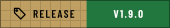


</div>
<!-- markdown:badges:end -->

> [!TIP]
> **This page is the kit drawing itself.** Its header, the badge row, the
> schematic, the trophy case and the footer are files the kit drew, in the
> `blueprint`, from the [same stub](#-one-stub) it asks you to copy. **To see
> profile mode, check out my profile, [@tannergolden](https://github.com/tannergolden).**

---

## 💡 What It Is

A README's images usually come from someone else's server, one request on
every page view, and a header typed by hand is out of date the day your
description changes. This kit draws them instead, and keeps them current: one
scheduled run measures the page over GitHub's API and git, draws every image
as an SVG, writes the README's blocks, and commits the lot once.

| Part         | What it draws                                                                           |
| :----------- | :-------------------------------------------------------------------------------------- |
| **Banners**  | The header and the footer, and the links under the footer.                              |
| **Badges**   | A row of static badges, and a row of live ones whose value and colour the run measures. |
| **Elements** | The body: a schematic, instruments, milestones, a roster, a certificate, placards.      |
| **Trophies** | The trophy case: eight core trophies with their tiers, and a hundred achievements.      |

Every image is a **committed file**, served by GitHub with the rest of the
repository, so nothing rate-limits it and no third party sits in the path. A
page is a person's profile or a repository.

- **Status**: Active, on the `v1` line.

---

## 🚀 Quick Start

### 📄 One Stub

Your repository holds one small workflow that names the schedule. The
checkout, the measurement, the drawing and the commit all happen here, so a fix
lands once and reaches every README pinned to `v1`.

<details>
<summary>The whole stub, <code>.github/workflows/markdown.yml</code></summary>

```yaml
# .github/workflows/markdown.yml
name: '📝 Markdown'

on:
  schedule:
    - cron: '0 0 * * *' # every night at midnight UTC
  workflow_dispatch:

concurrency: # one drawing at a time; the next waits its turn
  group: markdown-${{ github.ref }}
  cancel-in-progress: false

permissions: {}

jobs:
  markdown:
    permissions:
      contents: write # the images, the README's blocks and the lock
      pull-requests: write # only used with commit: pr
    uses: tannergolden/markdown/.github/workflows/markdown.yml@v1
    secrets:
      MARKDOWN_TOKEN: ${{ secrets.MARKDOWN_TOKEN }} # the one secret the kit reads
```

</details>

With no settings at all, the page gets a header and a footer read from GitHub
and a trophy case, in the `standard` theme. The stub sets the choices made
most often, such as `mode` (`profile` or `repository`), `theme`, `holidays`,
`check` and `commit` (`push`, or `pr` for a pull request); everything else
lives in `.github/markdown.yaml`, and
[`docs/references/Settings.md`](docs/references/Settings.md) has every key.
`MARKDOWN_TOKEN` is optional: `GITHUB_TOKEN` reads everything public.

---

## 📖 Using It

### 🧭 How A Run Draws A Page

<!-- markdown:element:how-it-runs:start -->
<picture>
  <source media="(max-width: 585px) and (prefers-color-scheme: dark)" srcset="assets/elements/how-it-runs-narrow-dark.svg">
  <source media="(max-width: 585px)" srcset="assets/elements/how-it-runs-narrow-day.svg">
  <source media="(prefers-color-scheme: dark)" srcset="assets/elements/how-it-runs-dark.svg">
  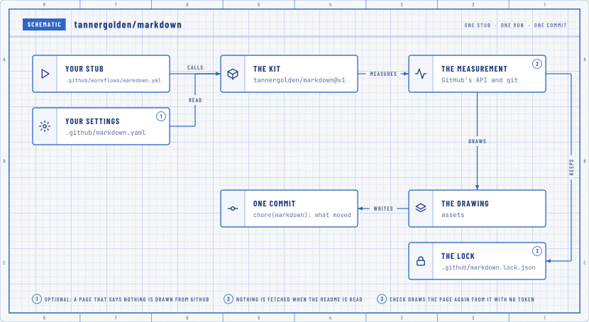
</picture>
<!-- markdown:element:how-it-runs:end -->

Each run measures everything again, so a run GitHub delays or drops loses
nothing, and a day on which nothing moved writes nothing. The kit owns only
what sits between its markers in the README, so every word of yours around
them stays yours. On a first run the header goes at the top, the badges under
it, the trophy case over the footer and the footer at the foot; an element
goes where you put its markers.

### 🎨 One Theme For The Whole Page

One setting colours everything, so the header, the badges, the body and the
trophy case read as one family: `standard`, the default; eleven prints, from
`redprint` to `blackprint`, and `rainbowprint`; your own prints; pixel themes
such as `heaven-and-hell` and `brain`; and collections such as `medieval` and
`matrix`, a design for each month. Around each holiday its set takes the page
for a few days, and on the page's birthday the Birthday set does.
[Themes and Sets](docs/technical/Themes.md) defines each kind, and
`markdown-kit themes` lists every theme a page can pick.

<table>
  <tr>
    <td width="50%" align="center">
      <a href="https://raw.githack.com/tannergolden/markdown/Development/docs/references/themes/index.html#standard"><picture><source media="(prefers-color-scheme: dark)" srcset="docs/references/themes/standard/h2-still-dark.svg">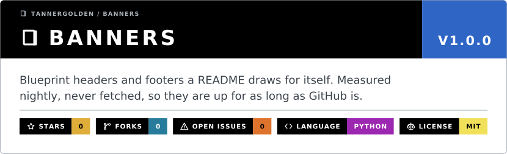</picture></a>
      <br /><sub><code>standard</code>, the default</sub>
    </td>
    <td width="50%" align="center">
      <a href="https://raw.githack.com/tannergolden/markdown/Development/docs/references/themes/index.html#blueprint"><picture><source media="(prefers-color-scheme: dark)" srcset="docs/references/themes/blueprint/h2-still-dark.svg">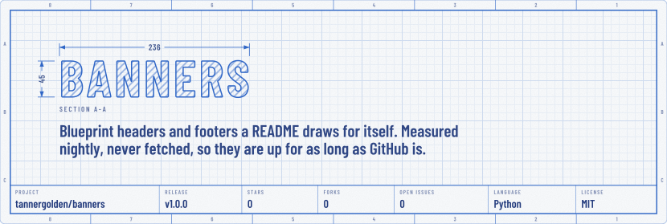</picture></a>
      <br /><sub><code>blueprint</code>, this page's print</sub>
    </td>
  </tr>
  <tr>
    <td width="50%" align="center">
      <a href="https://raw.githack.com/tannergolden/markdown/Development/docs/references/themes/index.html#halloween"><picture><source media="(prefers-color-scheme: dark)" srcset="docs/references/themes/halloween/h2-still-dark.svg">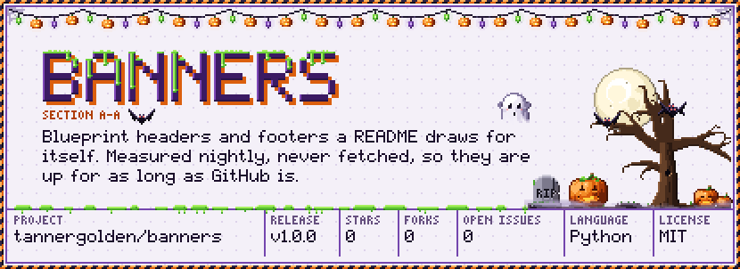</picture></a>
      <br /><sub>Halloween's set, October 30 to November 1</sub>
    </td>
    <td width="50%" align="center">
      <a href="https://raw.githack.com/tannergolden/markdown/Development/docs/references/themes/index.html#christmas"><picture><source media="(prefers-color-scheme: dark)" srcset="docs/references/themes/christmas/h2-still-dark.svg">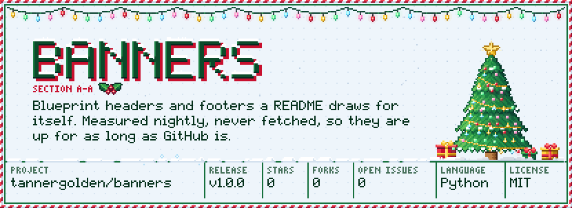</picture></a>
      <br /><sub>Christmas's set, December 24 to 26</sub>
    </td>
  </tr>
  <tr>
    <td width="50%" align="center">
      <a href="https://raw.githack.com/tannergolden/markdown/Development/docs/references/themes/index.html#heaven-and-hell">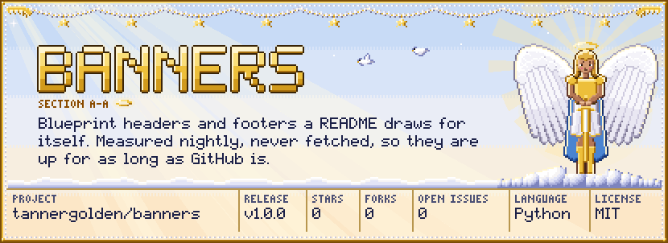</a>
      <br /><sub><code>heaven-and-hell</code> in light mode</sub>
    </td>
    <td width="50%" align="center">
      <a href="https://raw.githack.com/tannergolden/markdown/Development/docs/references/themes/index.html#heaven-and-hell">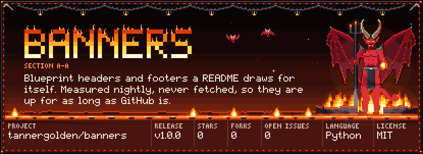</a>
      <br /><sub><code>heaven-and-hell</code> in dark mode</sub>
    </td>
  </tr>
  <tr>
    <td width="50%" align="center">
      <a href="https://raw.githack.com/tannergolden/markdown/Development/docs/references/themes/index.html#brain">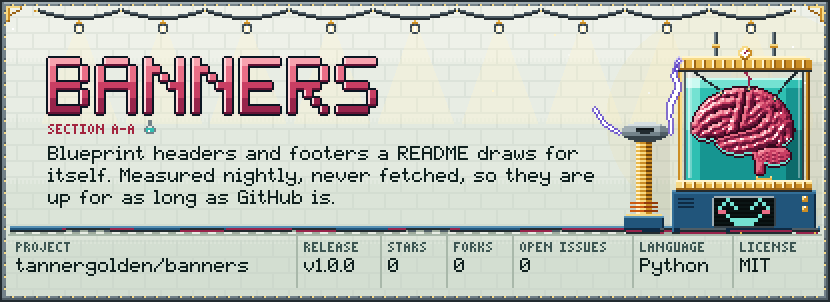</a>
      <br /><sub><code>brain</code> in light mode</sub>
    </td>
    <td width="50%" align="center">
      <a href="https://raw.githack.com/tannergolden/markdown/Development/docs/references/themes/index.html#brain">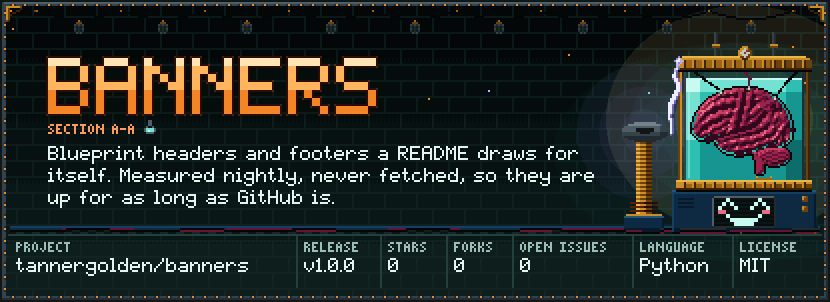</a>
      <br /><sub><code>brain</code> in dark mode</sub>
    </td>
  </tr>
</table>

<table>
  <tr>
    <td width="25%" align="center">
      <a href="https://raw.githack.com/tannergolden/markdown/Development/docs/references/themes/index.html#standard"><picture><source media="(prefers-color-scheme: dark)" srcset="docs/references/themes/standard/trophy-trophy-3-dark.svg"></picture></a>
      <br /><sub><code>standard</code></sub>
    </td>
    <td width="25%" align="center">
      <a href="https://raw.githack.com/tannergolden/markdown/Development/docs/references/themes/index.html#blueprint"><picture><source media="(prefers-color-scheme: dark)" srcset="docs/references/themes/blueprint/trophy-trophy-3-dark.svg"></picture></a>
      <br /><sub><code>blueprint</code></sub>
    </td>
    <td width="25%" align="center">
      <a href="https://raw.githack.com/tannergolden/markdown/Development/docs/references/themes/index.html#halloween"><picture><source media="(prefers-color-scheme: dark)" srcset="docs/references/themes/halloween/trophy-trophy-3-dark.svg">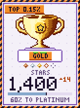</picture></a>
      <br /><sub>Halloween's set</sub>
    </td>
    <td width="25%" align="center">
      <a href="https://raw.githack.com/tannergolden/markdown/Development/docs/references/themes/medieval/index.html"><picture><source media="(prefers-color-scheme: dark)" srcset="docs/references/themes/medieval/medieval-forge/trophy-trophy-3-dark.svg">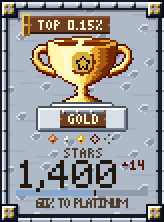</picture></a>
      <br /><sub><code>medieval</code> in November</sub>
    </td>
  </tr>
</table>

**[See every theme, drawn by the kit](https://raw.githack.com/tannergolden/markdown/Development/docs/references/themes/index.html)**,
on GitHub's light and dark grounds, at the size a README shows them.

### ♟️ The Games On @tannergolden's Profile

The kit also draws four games, Chess, Checkers, Pentago and Tic-Tac, for one
page alone: [@tannergolden's profile](https://github.com/tannergolden), where
anyone on GitHub can play the next move through
[tannergolden/play](https://github.com/tannergolden/play). Any other page whose
settings name them is told so. Their designs are proprietary, under
[`LICENSE-GAMES`](LICENSE-GAMES).

<table>
  <tr>
    <td width="50%" align="center">
      <a href="https://raw.githack.com/tannergolden/markdown/Development/docs/references/themes/index.html#chess"><picture><source media="(prefers-color-scheme: dark)" srcset="docs/references/themes/chess/chess-wide-blackprint-still-dark.svg">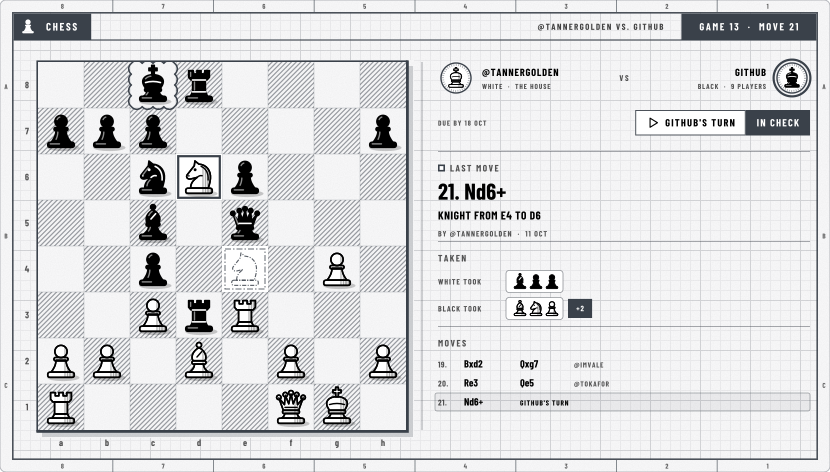</picture></a>
      <br /><sub>Chess, in <code>blackprint</code></sub>
    </td>
    <td width="50%" align="center">
      <a href="https://raw.githack.com/tannergolden/markdown/Development/docs/references/themes/index.html#checkers"><picture><source media="(prefers-color-scheme: dark)" srcset="docs/references/themes/checkers/checkers-wide-blackprint-still-dark.svg">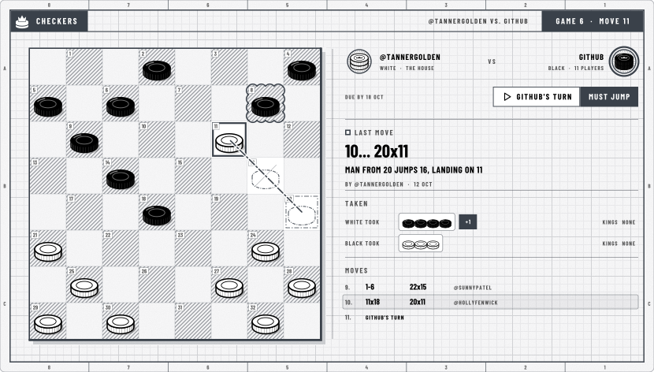</picture></a>
      <br /><sub>Checkers, in <code>blackprint</code></sub>
    </td>
  </tr>
  <tr>
    <td width="50%" align="center">
      <a href="https://raw.githack.com/tannergolden/markdown/Development/docs/references/themes/index.html#pentago"><picture><source media="(prefers-color-scheme: dark)" srcset="docs/references/themes/pentago/pentago-wide-blackprint-still-dark.svg">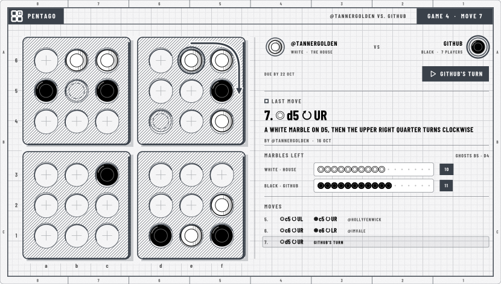</picture></a>
      <br /><sub>Pentago, in <code>blackprint</code></sub>
    </td>
    <td width="50%" align="center">
      <a href="https://raw.githack.com/tannergolden/markdown/Development/docs/references/themes/index.html#tictac"><picture><source media="(prefers-color-scheme: dark)" srcset="docs/references/themes/tictac/tictac-wide-blackprint-still-dark.svg">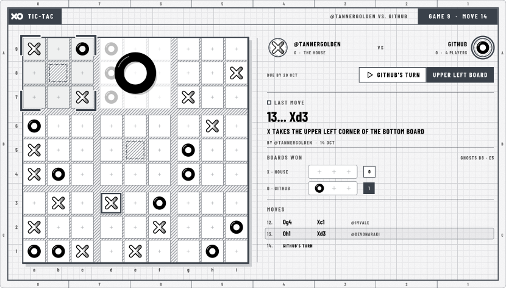</picture></a>
      <br /><sub>Tic-Tac, in <code>blackprint</code></sub>
    </td>
  </tr>
  <tr>
    <td width="50%" align="center">
      <a href="https://raw.githack.com/tannergolden/markdown/Development/docs/references/themes/index.html#chess"><picture><source media="(prefers-color-scheme: dark)" srcset="docs/references/themes/chess/chess-wide-standard-still-dark.svg">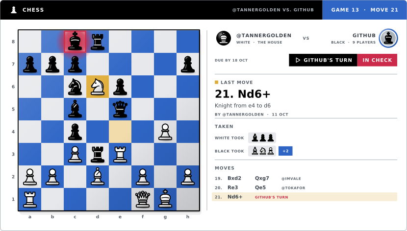</picture></a>
      <br /><sub>Chess, in <code>standard</code></sub>
    </td>
    <td width="50%" align="center">
      <a href="https://raw.githack.com/tannergolden/markdown/Development/docs/references/themes/index.html#checkers"><picture><source media="(prefers-color-scheme: dark)" srcset="docs/references/themes/checkers/checkers-wide-standard-still-dark.svg">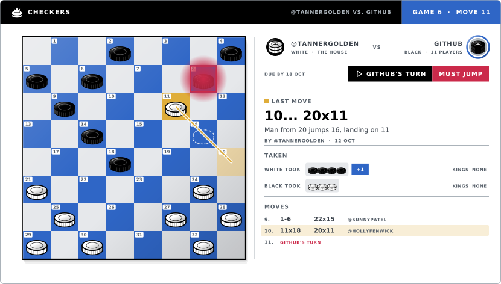</picture></a>
      <br /><sub>Checkers, in <code>standard</code></sub>
    </td>
  </tr>
  <tr>
    <td width="50%" align="center">
      <a href="https://raw.githack.com/tannergolden/markdown/Development/docs/references/themes/index.html#pentago"><picture><source media="(prefers-color-scheme: dark)" srcset="docs/references/themes/pentago/pentago-wide-standard-still-dark.svg">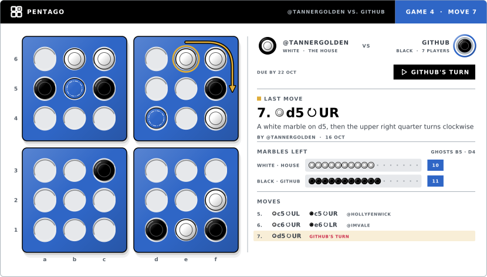</picture></a>
      <br /><sub>Pentago, in <code>standard</code></sub>
    </td>
    <td width="50%" align="center">
      <a href="https://raw.githack.com/tannergolden/markdown/Development/docs/references/themes/index.html#tictac"><picture><source media="(prefers-color-scheme: dark)" srcset="docs/references/themes/tictac/tictac-wide-standard-still-dark.svg">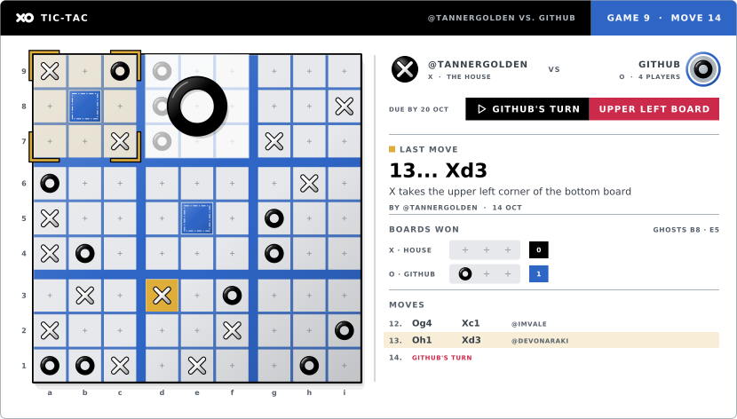</picture></a>
      <br /><sub>Tic-Tac, in <code>standard</code></sub>
    </td>
  </tr>
  <tr>
    <td width="50%" align="center">
      <a href="https://raw.githack.com/tannergolden/markdown/Development/docs/references/themes/index.html#hall-of-fame"><picture><source media="(prefers-color-scheme: dark)" srcset="docs/references/themes/hall-of-fame/hall-of-fame-wide-blackprint-still-dark.svg">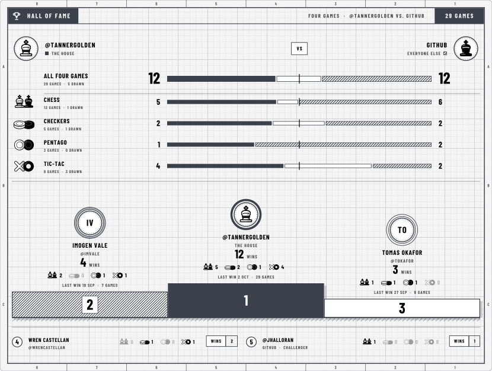</picture></a>
      <br /><sub>The Hall of Fame, in <code>blackprint</code></sub>
    </td>
    <td width="50%" align="center">
      <a href="https://raw.githack.com/tannergolden/markdown/Development/docs/references/themes/index.html#hall-of-fame"><picture><source media="(prefers-color-scheme: dark)" srcset="docs/references/themes/hall-of-fame/hall-of-fame-wide-standard-still-dark.svg">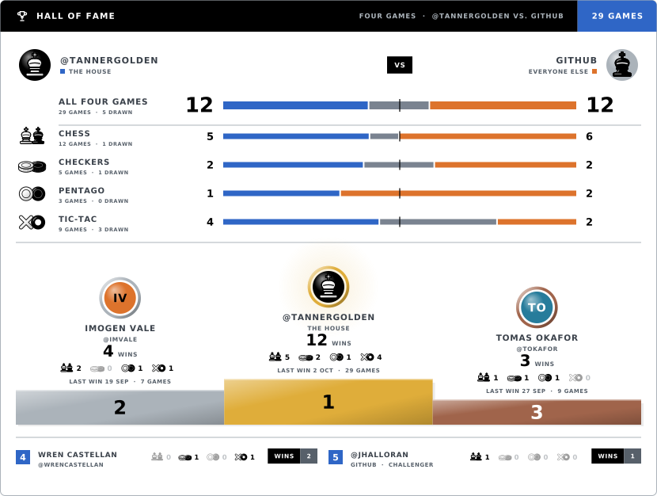</picture></a>
      <br /><sub>The Hall of Fame, in <code>standard</code></sub>
    </td>
  </tr>
  <tr>
    <td width="50%" align="center">
      <a href="https://raw.githack.com/tannergolden/markdown/Development/docs/references/themes/index.html#chess"><picture><source media="(prefers-color-scheme: dark)" srcset="docs/references/themes/chess/chess-wide-halloween-still-dark.svg">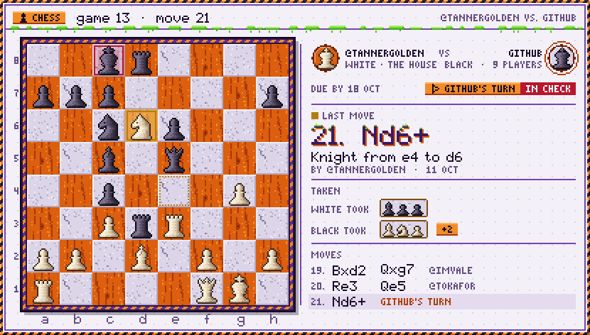</picture></a>
      <br /><sub>Chess, in the <code>halloween</code> set</sub>
    </td>
    <td width="50%" align="center">
      <a href="https://raw.githack.com/tannergolden/markdown/Development/docs/references/themes/index.html#hall-of-fame"><picture><source media="(prefers-color-scheme: dark)" srcset="docs/references/themes/hall-of-fame/hall-of-fame-wide-medieval-hoard-still-dark.svg">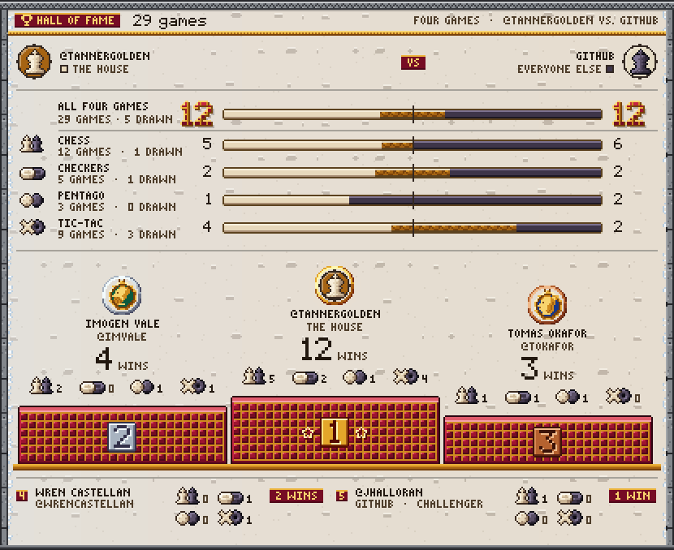</picture></a>
      <br /><sub>The Hall of Fame, in <code>medieval-hoard</code>, December's design</sub>
    </td>
  </tr>
</table>

### 🔍 Checking A Page

The lock, `.github/markdown.lock.json`, keeps what each run measured, so the
committed page can be drawn again with no token and no network and compared
with what is committed. For pull-request CI:

```yaml
on: pull_request

jobs:
  page:
    permissions:
      contents: write
      pull-requests: write
    uses: tannergolden/markdown/.github/workflows/markdown.yml@v1
    with:
      check: true
```

### 🖥️ On Your Own Machine

The kit is standard-library Python, 3.10 or later, with nothing to install:

```bash
python3 src/markdown-kit.py preview --root /tmp/page       # a sample page, the way a run draws it
python3 src/markdown-kit.py check --root .                 # is the committed page current?
python3 src/markdown-kit.py themes                         # every theme a page can pick, by kind
```

`python3 src/markdown-kit.py --help` lists the rest, and `make lint test` runs
everything CI runs. [`.github/workflows/README.md`](.github/workflows/README.md)
logs every workflow here.

---

## 📦 What's Inside

| Path                             | Purpose                                                                                                                            |
| :------------------------------- | :--------------------------------------------------------------------------------------------------------------------------------- |
| `.github/workflows/markdown.yml` | **The workflow** every stub calls: checkout, the kit, the commit                                                                   |
| `.github/actions/markdown/`      | **The action** the workflow runs: one run of the kit on the checkout                                                               |
| `src/markdown-kit.py`            | **The kit's** command line, and the one place its layers meet                                                                      |
| `src/domain/`                    | What a page looks like: the palette, the lettering, the themes and every drawing                                                   |
| `src/app/`                       | What a run does: the settings, the measurement, the plan and the commit                                                            |
| `src/infra/`                     | Files, git, GitHub's API, the clock, and the kit's data files                                                                      |
| `docs/`                          | [Settings](docs/references/Settings.md), the trophies' [catalogue](docs/references/Catalogue.md), and the decisions behind the kit |
| `docs/references/themes/`        | The theme-sets page: every theme as the kit draws it, from `make themes`                                                           |
| `tests/`                         | Unit, integration and end-to-end suites, and the fixtures they check against                                                       |

---

## 🤝 Getting Involved

- **Questions**: [`SUPPORT.md`](/.github/SUPPORT.md) says where to ask.
- **A bug or an idea**: open an issue from one of the forms.
- **A change**: [`CONTRIBUTING.md`](/.github/CONTRIBUTING.md) explains how,
  every change follows the
  [standards](https://github.com/tannergolden/standards/blob/Development/docs/README.md)
  by link, and every contribution follows the
  [code of conduct](/.github/CODE_OF_CONDUCT.md).
- **Who decides**: [`GOVERNANCE.md`](/.github/GOVERNANCE.md) names the
  maintainers.

---

## 🛡️ Security

Report a vulnerability privately, never in an issue:
[`SECURITY.md`](/.github/SECURITY.md) says how, and how fast a fix follows.

---

## ⚖️ Licence

The kit is released under the terms in [LICENSE](/LICENSE). The games'
materials are not: they are proprietary, under [`LICENSE-GAMES`](LICENSE-GAMES).

---

<!-- markdown:trophies:start -->
<p align="center">
  <picture><source media="(prefers-color-scheme: dark)" srcset="assets/trophies/level.svg">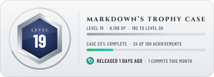</picture>
  <picture><source media="(prefers-color-scheme: dark)" srcset="assets/trophies/next-up.svg">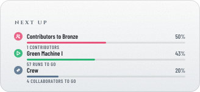</picture>
</p>

<p align="center">
  <a href="https://github.com/tannergolden/markdown/blob/HEAD/docs/Catalogue.md#repository-stars"><picture><source media="(prefers-color-scheme: dark)" srcset="assets/trophies/stars.svg"></picture></a>
  <a href="https://github.com/tannergolden/markdown/blob/HEAD/docs/Catalogue.md#repository-forks"><picture><source media="(prefers-color-scheme: dark)" srcset="assets/trophies/forks.svg"></picture></a>
  <a href="https://github.com/tannergolden/markdown/blob/HEAD/docs/Catalogue.md#repository-contributors"><picture><source media="(prefers-color-scheme: dark)" srcset="assets/trophies/contributors.svg"></picture></a>
  <a href="https://github.com/tannergolden/markdown/blob/HEAD/docs/Catalogue.md#repository-commits"><picture><source media="(prefers-color-scheme: dark)" srcset="assets/trophies/commits.svg"></picture></a>
  <a href="https://github.com/tannergolden/markdown/blob/HEAD/docs/Catalogue.md#repository-releases"><picture><source media="(prefers-color-scheme: dark)" srcset="assets/trophies/releases.svg"></picture></a>
  <a href="https://github.com/tannergolden/markdown/blob/HEAD/docs/Catalogue.md#repository-merged"><picture><source media="(prefers-color-scheme: dark)" srcset="assets/trophies/merged.svg"></picture></a>
  <a href="https://github.com/tannergolden/markdown/blob/HEAD/docs/Catalogue.md#repository-resolved"><picture><source media="(prefers-color-scheme: dark)" srcset="assets/trophies/resolved.svg"></picture></a>
  <a href="https://github.com/tannergolden/markdown/blob/HEAD/docs/Catalogue.md#repository-active"><picture><source media="(prefers-color-scheme: dark)" srcset="assets/trophies/active.svg"></picture></a>
</p>

<details>
<summary><b>Achievements</b> · 30 of 100 earned · next: Issues Resolved to Bronze, 60%</summary>

<p align="center"><b>Launch</b></p>
<p align="center">
  <a href="https://github.com/tannergolden/markdown/blob/HEAD/docs/Catalogue.md#repository-first-release"><picture><source media="(prefers-color-scheme: dark)" srcset="assets/trophies/achievements/first-release.svg"></picture></a>
  <a href="https://github.com/tannergolden/markdown/blob/HEAD/docs/Catalogue.md#repository-filed"><picture><source media="(prefers-color-scheme: dark)" srcset="assets/trophies/achievements/filed.svg"></picture></a>
  <a href="https://github.com/tannergolden/markdown/blob/HEAD/docs/Catalogue.md#repository-first-tag"><picture><source media="(prefers-color-scheme: dark)" srcset="assets/trophies/achievements/first-tag.svg"></picture></a>
  <a href="https://github.com/tannergolden/markdown/blob/HEAD/docs/Catalogue.md#repository-stranger-report"><picture><source media="(prefers-color-scheme: dark)" srcset="assets/trophies/achievements/stranger-report.svg"></picture></a>
  <a href="https://github.com/tannergolden/markdown/blob/HEAD/docs/Catalogue.md#repository-named"><picture><source media="(prefers-color-scheme: dark)" srcset="assets/trophies/achievements/named.svg"></picture></a>
  <a href="https://github.com/tannergolden/markdown/blob/HEAD/docs/Catalogue.md#repository-first-fork"><picture><source media="(prefers-color-scheme: dark)" srcset="assets/trophies/achievements/first-fork.svg"></picture></a>
  <a href="https://github.com/tannergolden/markdown/blob/HEAD/docs/Catalogue.md#repository-first-merge"><picture><source media="(prefers-color-scheme: dark)" srcset="assets/trophies/achievements/first-merge.svg"></picture></a>
  <a href="https://github.com/tannergolden/markdown/blob/HEAD/docs/Catalogue.md#repository-first-star"><picture><source media="(prefers-color-scheme: dark)" srcset="assets/trophies/achievements/first-star.svg"></picture></a>
  <a href="https://github.com/tannergolden/markdown/blob/HEAD/docs/Catalogue.md#repository-first-watcher"><picture><source media="(prefers-color-scheme: dark)" srcset="assets/trophies/achievements/first-watcher.svg"></picture></a>
  <a href="https://github.com/tannergolden/markdown/blob/HEAD/docs/Catalogue.md#repository-front-door"><picture><source media="(prefers-color-scheme: dark)" srcset="assets/trophies/achievements/front-door.svg"></picture></a>
  <a href="https://github.com/tannergolden/markdown/blob/HEAD/docs/Catalogue.md#repository-outside-help"><picture><source media="(prefers-color-scheme: dark)" srcset="assets/trophies/achievements/outside-help.svg"></picture></a>
  <a href="https://github.com/tannergolden/markdown/blob/HEAD/docs/Catalogue.md#repository-poster"><picture><source media="(prefers-color-scheme: dark)" srcset="assets/trophies/achievements/poster.svg"></picture></a>
</p>

<p align="center"><b>Health</b></p>
<p align="center">
  <a href="https://github.com/tannergolden/markdown/blob/HEAD/docs/Catalogue.md#repository-gatekeeper"><picture><source media="(prefers-color-scheme: dark)" srcset="assets/trophies/achievements/gatekeeper.svg"></picture></a>
  <a href="https://github.com/tannergolden/markdown/blob/HEAD/docs/Catalogue.md#repository-locksmith"><picture><source media="(prefers-color-scheme: dark)" srcset="assets/trophies/achievements/locksmith.svg"></picture></a>
  <a href="https://github.com/tannergolden/markdown/blob/HEAD/docs/Catalogue.md#repository-paperwork"><picture><source media="(prefers-color-scheme: dark)" srcset="assets/trophies/achievements/paperwork.svg"></picture></a>
  <a href="https://github.com/tannergolden/markdown/blob/HEAD/docs/Catalogue.md#repository-support-line"><picture><source media="(prefers-color-scheme: dark)" srcset="assets/trophies/achievements/support-line.svg"></picture></a>
  <a href="https://github.com/tannergolden/markdown/blob/HEAD/docs/Catalogue.md#repository-town-hall"><picture><source media="(prefers-color-scheme: dark)" srcset="assets/trophies/achievements/town-hall.svg"></picture></a>
  <a href="https://github.com/tannergolden/markdown/blob/HEAD/docs/Catalogue.md#repository-auto-pilot"><picture><source media="(prefers-color-scheme: dark)" srcset="assets/trophies/achievements/auto-pilot.svg"></picture></a>
  <a href="https://github.com/tannergolden/markdown/blob/HEAD/docs/Catalogue.md#repository-form-filler"><picture><source media="(prefers-color-scheme: dark)" srcset="assets/trophies/achievements/form-filler.svg"></picture></a>
  <a href="https://github.com/tannergolden/markdown/blob/HEAD/docs/Catalogue.md#repository-house-rules"><picture><source media="(prefers-color-scheme: dark)" srcset="assets/trophies/achievements/house-rules.svg"></picture></a>
  <a href="https://github.com/tannergolden/markdown/blob/HEAD/docs/Catalogue.md#repository-label-maker"><picture><source media="(prefers-color-scheme: dark)" srcset="assets/trophies/achievements/label-maker.svg"></picture></a>
  <a href="https://github.com/tannergolden/markdown/blob/HEAD/docs/Catalogue.md#repository-welcome-mat"><picture><source media="(prefers-color-scheme: dark)" srcset="assets/trophies/achievements/welcome-mat.svg"></picture></a>
  <a href="https://github.com/tannergolden/markdown/blob/HEAD/docs/Catalogue.md#repository-well-formed"><picture><source media="(prefers-color-scheme: dark)" srcset="assets/trophies/achievements/well-formed.svg"></picture></a>
  <a href="https://github.com/tannergolden/markdown/blob/HEAD/docs/Catalogue.md#repository-clean-bill"><picture><source media="(prefers-color-scheme: dark)" srcset="assets/trophies/achievements/clean-bill.svg"></picture></a>
  <a href="https://github.com/tannergolden/markdown/blob/HEAD/docs/Catalogue.md#repository-documented"><picture><source media="(prefers-color-scheme: dark)" srcset="assets/trophies/achievements/documented.svg"></picture></a>
  <a href="https://github.com/tannergolden/markdown/blob/HEAD/docs/Catalogue.md#repository-licensed"><picture><source media="(prefers-color-scheme: dark)" srcset="assets/trophies/achievements/licensed.svg"></picture></a>
  <a href="https://github.com/tannergolden/markdown/blob/HEAD/docs/Catalogue.md#repository-changelog"><picture><source media="(prefers-color-scheme: dark)" srcset="assets/trophies/achievements/changelog.svg"></picture></a>
  <a href="https://github.com/tannergolden/markdown/blob/HEAD/docs/Catalogue.md#repository-open-hand"><picture><source media="(prefers-color-scheme: dark)" srcset="assets/trophies/achievements/open-hand.svg"></picture></a>
  <a href="https://github.com/tannergolden/markdown/blob/HEAD/docs/Catalogue.md#repository-protected"><picture><source media="(prefers-color-scheme: dark)" srcset="assets/trophies/achievements/protected.svg"></picture></a>
  <a href="https://github.com/tannergolden/markdown/blob/HEAD/docs/Catalogue.md#repository-roadmap"><picture><source media="(prefers-color-scheme: dark)" srcset="assets/trophies/achievements/roadmap.svg"></picture></a>
</p>

<p align="center"><b>Craft</b></p>
<p align="center">
  <a href="https://github.com/tannergolden/markdown/blob/HEAD/docs/Catalogue.md#repository-follows-the-standards"><picture><source media="(prefers-color-scheme: dark)" srcset="assets/trophies/achievements/follows-the-standards.svg"></picture></a>
  <a href="https://github.com/tannergolden/markdown/blob/HEAD/docs/Catalogue.md#repository-golden-path"><picture><source media="(prefers-color-scheme: dark)" srcset="assets/trophies/achievements/golden-path.svg"></picture></a>
  <a href="https://github.com/tannergolden/markdown/blob/HEAD/docs/Catalogue.md#repository-ready-room"><picture><source media="(prefers-color-scheme: dark)" srcset="assets/trophies/achievements/ready-room.svg"></picture></a>
  <a href="https://github.com/tannergolden/markdown/blob/HEAD/docs/Catalogue.md#repository-by-the-book"><picture><source media="(prefers-color-scheme: dark)" srcset="assets/trophies/achievements/by-the-book.svg"></picture></a>
  <a href="https://github.com/tannergolden/markdown/blob/HEAD/docs/Catalogue.md#repository-green-machine"><picture><source media="(prefers-color-scheme: dark)" srcset="assets/trophies/achievements/green-machine.svg"></picture></a>
  <a href="https://github.com/tannergolden/markdown/blob/HEAD/docs/Catalogue.md#repository-signed"><picture><source media="(prefers-color-scheme: dark)" srcset="assets/trophies/achievements/signed.svg"></picture></a>
  <a href="https://github.com/tannergolden/markdown/blob/HEAD/docs/Catalogue.md#repository-test-suite"><picture><source media="(prefers-color-scheme: dark)" srcset="assets/trophies/achievements/test-suite.svg"></picture></a>
  <a href="https://github.com/tannergolden/markdown/blob/HEAD/docs/Catalogue.md#repository-wired"><picture><source media="(prefers-color-scheme: dark)" srcset="assets/trophies/achievements/wired.svg"></picture></a>
  <a href="https://github.com/tannergolden/markdown/blob/HEAD/docs/Catalogue.md#repository-squeaky"><picture><source media="(prefers-color-scheme: dark)" srcset="assets/trophies/achievements/squeaky.svg"></picture></a>
  <a href="https://github.com/tannergolden/markdown/blob/HEAD/docs/Catalogue.md#repository-release-notes"><picture><source media="(prefers-color-scheme: dark)" srcset="assets/trophies/achievements/release-notes.svg"></picture></a>
  <a href="https://github.com/tannergolden/markdown/blob/HEAD/docs/Catalogue.md#repository-semver"><picture><source media="(prefers-color-scheme: dark)" srcset="assets/trophies/achievements/semver.svg"></picture></a>
  <a href="https://github.com/tannergolden/markdown/blob/HEAD/docs/Catalogue.md#repository-containerized"><picture><source media="(prefers-color-scheme: dark)" srcset="assets/trophies/achievements/containerized.svg"></picture></a>
  <a href="https://github.com/tannergolden/markdown/blob/HEAD/docs/Catalogue.md#repository-gitmoji"><picture><source media="(prefers-color-scheme: dark)" srcset="assets/trophies/achievements/gitmoji.svg"></picture></a>
  <a href="https://github.com/tannergolden/markdown/blob/HEAD/docs/Catalogue.md#repository-packager"><picture><source media="(prefers-color-scheme: dark)" srcset="assets/trophies/achievements/packager.svg"></picture></a>
  <a href="https://github.com/tannergolden/markdown/blob/HEAD/docs/Catalogue.md#repository-prerelease"><picture><source media="(prefers-color-scheme: dark)" srcset="assets/trophies/achievements/prerelease.svg"></picture></a>
  <a href="https://github.com/tannergolden/markdown/blob/HEAD/docs/Catalogue.md#repository-small-steps"><picture><source media="(prefers-color-scheme: dark)" srcset="assets/trophies/achievements/small-steps.svg"></picture></a>
</p>

<p align="center"><b>Community</b></p>
<p align="center">
  <a href="https://github.com/tannergolden/markdown/blob/HEAD/docs/Catalogue.md#repository-triage"><picture><source media="(prefers-color-scheme: dark)" srcset="assets/trophies/achievements/triage.svg"></picture></a>
  <a href="https://github.com/tannergolden/markdown/blob/HEAD/docs/Catalogue.md#repository-crew"><picture><source media="(prefers-color-scheme: dark)" srcset="assets/trophies/achievements/crew.svg"></picture></a>
  <a href="https://github.com/tannergolden/markdown/blob/HEAD/docs/Catalogue.md#repository-regulars"><picture><source media="(prefers-color-scheme: dark)" srcset="assets/trophies/achievements/regulars.svg"></picture></a>
  <a href="https://github.com/tannergolden/markdown/blob/HEAD/docs/Catalogue.md#repository-ten-strong"><picture><source media="(prefers-color-scheme: dark)" srcset="assets/trophies/achievements/ten-strong.svg"></picture></a>
  <a href="https://github.com/tannergolden/markdown/blob/HEAD/docs/Catalogue.md#repository-long-thread"><picture><source media="(prefers-color-scheme: dark)" srcset="assets/trophies/achievements/long-thread.svg"></picture></a>
  <a href="https://github.com/tannergolden/markdown/blob/HEAD/docs/Catalogue.md#repository-talkative"><picture><source media="(prefers-color-scheme: dark)" srcset="assets/trophies/achievements/talkative.svg"></picture></a>
  <a href="https://github.com/tannergolden/markdown/blob/HEAD/docs/Catalogue.md#repository-answered"><picture><source media="(prefers-color-scheme: dark)" srcset="assets/trophies/achievements/answered.svg"></picture></a>
  <a href="https://github.com/tannergolden/markdown/blob/HEAD/docs/Catalogue.md#repository-fast-reply"><picture><source media="(prefers-color-scheme: dark)" srcset="assets/trophies/achievements/fast-reply.svg"></picture></a>
  <a href="https://github.com/tannergolden/markdown/blob/HEAD/docs/Catalogue.md#repository-good-first-issues"><picture><source media="(prefers-color-scheme: dark)" srcset="assets/trophies/achievements/good-first-issues.svg"></picture></a>
  <a href="https://github.com/tannergolden/markdown/blob/HEAD/docs/Catalogue.md#repository-help-wanted"><picture><source media="(prefers-color-scheme: dark)" srcset="assets/trophies/achievements/help-wanted.svg"></picture></a>
  <a href="https://github.com/tannergolden/markdown/blob/HEAD/docs/Catalogue.md#repository-mentor"><picture><source media="(prefers-color-scheme: dark)" srcset="assets/trophies/achievements/mentor.svg"></picture></a>
  <a href="https://github.com/tannergolden/markdown/blob/HEAD/docs/Catalogue.md#repository-org-backed"><picture><source media="(prefers-color-scheme: dark)" srcset="assets/trophies/achievements/org-backed.svg"></picture></a>
  <a href="https://github.com/tannergolden/markdown/blob/HEAD/docs/Catalogue.md#repository-outside-merges"><picture><source media="(prefers-color-scheme: dark)" srcset="assets/trophies/achievements/outside-merges.svg"></picture></a>
  <a href="https://github.com/tannergolden/markdown/blob/HEAD/docs/Catalogue.md#repository-popular-opinion"><picture><source media="(prefers-color-scheme: dark)" srcset="assets/trophies/achievements/popular-opinion.svg"></picture></a>
  <a href="https://github.com/tannergolden/markdown/blob/HEAD/docs/Catalogue.md#repository-reviewed"><picture><source media="(prefers-color-scheme: dark)" srcset="assets/trophies/achievements/reviewed.svg"></picture></a>
  <a href="https://github.com/tannergolden/markdown/blob/HEAD/docs/Catalogue.md#repository-well-maintained"><picture><source media="(prefers-color-scheme: dark)" srcset="assets/trophies/achievements/well-maintained.svg"></picture></a>
</p>

<p align="center"><b>Reach</b></p>
<p align="center">
  <a href="https://github.com/tannergolden/markdown/blob/HEAD/docs/Catalogue.md#repository-big-name"><picture><source media="(prefers-color-scheme: dark)" srcset="assets/trophies/achievements/big-name.svg"></picture></a>
  <a href="https://github.com/tannergolden/markdown/blob/HEAD/docs/Catalogue.md#repository-cloned"><picture><source media="(prefers-color-scheme: dark)" srcset="assets/trophies/achievements/cloned.svg"></picture></a>
  <a href="https://github.com/tannergolden/markdown/blob/HEAD/docs/Catalogue.md#repository-downloaded"><picture><source media="(prefers-color-scheme: dark)" srcset="assets/trophies/achievements/downloaded.svg"></picture></a>
  <a href="https://github.com/tannergolden/markdown/blob/HEAD/docs/Catalogue.md#repository-fork-magnet"><picture><source media="(prefers-color-scheme: dark)" srcset="assets/trophies/achievements/fork-magnet.svg"></picture></a>
  <a href="https://github.com/tannergolden/markdown/blob/HEAD/docs/Catalogue.md#repository-forked-far"><picture><source media="(prefers-color-scheme: dark)" srcset="assets/trophies/achievements/forked-far.svg"></picture></a>
  <a href="https://github.com/tannergolden/markdown/blob/HEAD/docs/Catalogue.md#repository-living-forks"><picture><source media="(prefers-color-scheme: dark)" srcset="assets/trophies/achievements/living-forks.svg"></picture></a>
  <a href="https://github.com/tannergolden/markdown/blob/HEAD/docs/Catalogue.md#repository-referred"><picture><source media="(prefers-color-scheme: dark)" srcset="assets/trophies/achievements/referred.svg"></picture></a>
  <a href="https://github.com/tannergolden/markdown/blob/HEAD/docs/Catalogue.md#repository-registry"><picture><source media="(prefers-color-scheme: dark)" srcset="assets/trophies/achievements/registry.svg"></picture></a>
  <a href="https://github.com/tannergolden/markdown/blob/HEAD/docs/Catalogue.md#repository-star-of-the-week"><picture><source media="(prefers-color-scheme: dark)" srcset="assets/trophies/achievements/star-of-the-week.svg"></picture></a>
  <a href="https://github.com/tannergolden/markdown/blob/HEAD/docs/Catalogue.md#repository-stargazer-streak"><picture><source media="(prefers-color-scheme: dark)" srcset="assets/trophies/achievements/stargazer-streak.svg"></picture></a>
  <a href="https://github.com/tannergolden/markdown/blob/HEAD/docs/Catalogue.md#repository-trending"><picture><source media="(prefers-color-scheme: dark)" srcset="assets/trophies/achievements/trending.svg"></picture></a>
  <a href="https://github.com/tannergolden/markdown/blob/HEAD/docs/Catalogue.md#repository-used-by"><picture><source media="(prefers-color-scheme: dark)" srcset="assets/trophies/achievements/used-by.svg"></picture></a>
  <a href="https://github.com/tannergolden/markdown/blob/HEAD/docs/Catalogue.md#repository-visited"><picture><source media="(prefers-color-scheme: dark)" srcset="assets/trophies/achievements/visited.svg"></picture></a>
  <a href="https://github.com/tannergolden/markdown/blob/HEAD/docs/Catalogue.md#repository-watched"><picture><source media="(prefers-color-scheme: dark)" srcset="assets/trophies/achievements/watched.svg"></picture></a>
</p>

<p align="center"><b>Rhythm</b></p>
<p align="center">
  <a href="https://github.com/tannergolden/markdown/blob/HEAD/docs/Catalogue.md#repository-alive"><picture><source media="(prefers-color-scheme: dark)" srcset="assets/trophies/achievements/alive.svg"></picture></a>
  <a href="https://github.com/tannergolden/markdown/blob/HEAD/docs/Catalogue.md#repository-same-day-fix"><picture><source media="(prefers-color-scheme: dark)" srcset="assets/trophies/achievements/same-day-fix.svg"></picture></a>
  <a href="https://github.com/tannergolden/markdown/blob/HEAD/docs/Catalogue.md#repository-night-shift"><picture><source media="(prefers-color-scheme: dark)" srcset="assets/trophies/achievements/night-shift.svg"></picture></a>
  <a href="https://github.com/tannergolden/markdown/blob/HEAD/docs/Catalogue.md#repository-long-game"><picture><source media="(prefers-color-scheme: dark)" srcset="assets/trophies/achievements/long-game.svg"></picture></a>
  <a href="https://github.com/tannergolden/markdown/blob/HEAD/docs/Catalogue.md#repository-streak"><picture><source media="(prefers-color-scheme: dark)" srcset="assets/trophies/achievements/streak.svg"></picture></a>
  <a href="https://github.com/tannergolden/markdown/blob/HEAD/docs/Catalogue.md#repository-monthly-release"><picture><source media="(prefers-color-scheme: dark)" srcset="assets/trophies/achievements/monthly-release.svg"></picture></a>
  <a href="https://github.com/tannergolden/markdown/blob/HEAD/docs/Catalogue.md#repository-weekend-project"><picture><source media="(prefers-color-scheme: dark)" srcset="assets/trophies/achievements/weekend-project.svg"></picture></a>
  <a href="https://github.com/tannergolden/markdown/blob/HEAD/docs/Catalogue.md#repository-big-week"><picture><source media="(prefers-color-scheme: dark)" srcset="assets/trophies/achievements/big-week.svg"></picture></a>
  <a href="https://github.com/tannergolden/markdown/blob/HEAD/docs/Catalogue.md#repository-weekly-beat"><picture><source media="(prefers-color-scheme: dark)" srcset="assets/trophies/achievements/weekly-beat.svg"></picture></a>
  <a href="https://github.com/tannergolden/markdown/blob/HEAD/docs/Catalogue.md#repository-marathon-day"><picture><source media="(prefers-color-scheme: dark)" srcset="assets/trophies/achievements/marathon-day.svg"></picture></a>
  <a href="https://github.com/tannergolden/markdown/blob/HEAD/docs/Catalogue.md#repository-comeback"><picture><source media="(prefers-color-scheme: dark)" srcset="assets/trophies/achievements/comeback.svg"></picture></a>
  <a href="https://github.com/tannergolden/markdown/blob/HEAD/docs/Catalogue.md#repository-friday-deploy"><picture><source media="(prefers-color-scheme: dark)" srcset="assets/trophies/achievements/friday-deploy.svg"></picture></a>
</p>

<p align="center"><b>Secret</b></p>
<p align="center">
  <a href="https://github.com/tannergolden/markdown/blob/HEAD/docs/Catalogue.md#repository-birthday"><picture><source media="(prefers-color-scheme: dark)" srcset="assets/trophies/achievements/birthday.svg"></picture></a>
  <a href="https://github.com/tannergolden/markdown/blob/HEAD/docs/Catalogue.md#repository-constellation"><picture><source media="(prefers-color-scheme: dark)" srcset="assets/trophies/achievements/constellation.svg"></picture></a>
  <a href="https://github.com/tannergolden/markdown/blob/HEAD/docs/Catalogue.md#repository-friday-the-13th"><picture><source media="(prefers-color-scheme: dark)" srcset="assets/trophies/achievements/friday-the-13th.svg"></picture></a>
  <a href="https://github.com/tannergolden/markdown/blob/HEAD/docs/Catalogue.md#repository-full-house"><picture><source media="(prefers-color-scheme: dark)" srcset="assets/trophies/achievements/full-house.svg"></picture></a>
  <a href="https://github.com/tannergolden/markdown/blob/HEAD/docs/Catalogue.md#repository-ghost"><picture><source media="(prefers-color-scheme: dark)" srcset="assets/trophies/achievements/ghost.svg"></picture></a>
  <a href="https://github.com/tannergolden/markdown/blob/HEAD/docs/Catalogue.md#repository-green-wall"><picture><source media="(prefers-color-scheme: dark)" srcset="assets/trophies/achievements/green-wall.svg"></picture></a>
  <a href="https://github.com/tannergolden/markdown/blob/HEAD/docs/Catalogue.md#repository-leap-day"><picture><source media="(prefers-color-scheme: dark)" srcset="assets/trophies/achievements/leap-day.svg"></picture></a>
  <a href="https://github.com/tannergolden/markdown/blob/HEAD/docs/Catalogue.md#repository-midnight-oil"><picture><source media="(prefers-color-scheme: dark)" srcset="assets/trophies/achievements/midnight-oil.svg"></picture></a>
  <a href="https://github.com/tannergolden/markdown/blob/HEAD/docs/Catalogue.md#repository-new-year"><picture><source media="(prefers-color-scheme: dark)" srcset="assets/trophies/achievements/new-year.svg"></picture></a>
  <a href="https://github.com/tannergolden/markdown/blob/HEAD/docs/Catalogue.md#repository-palindrome"><picture><source media="(prefers-color-scheme: dark)" srcset="assets/trophies/achievements/palindrome.svg"></picture></a>
  <a href="https://github.com/tannergolden/markdown/blob/HEAD/docs/Catalogue.md#repository-round-number"><picture><source media="(prefers-color-scheme: dark)" srcset="assets/trophies/achievements/round-number.svg"></picture></a>
  <a href="https://github.com/tannergolden/markdown/blob/HEAD/docs/Catalogue.md#repository-the-answer"><picture><source media="(prefers-color-scheme: dark)" srcset="assets/trophies/achievements/the-answer.svg"></picture></a>
</p>

</details>

<p align="center"><sub>Refreshed daily by <a href="https://github.com/tannergolden/markdown">tannergolden/markdown</a> · Every trophy and achievement, what it is for and how to earn it: <a href="https://github.com/tannergolden/markdown/blob/HEAD/docs/Catalogue.md#repository">the catalogue</a>. Click any card for its entry.</sub></p>
<!-- markdown:trophies:end -->

<!-- markdown:footer:start -->
<div align="center">

<a href="#top">
<picture>
  <source media="(max-width: 585px) and (prefers-color-scheme: dark)" srcset="assets/banners/footer-narrow-dark.svg">
  <source media="(max-width: 585px)" srcset="assets/banners/footer-narrow-day.svg">
  <source media="(prefers-color-scheme: dark)" srcset="assets/banners/footer-dark.svg">
  
</picture>
</a>

<a href="https://github.com/tannergolden/markdown/issues"><picture><source media="(prefers-color-scheme: dark)" srcset="assets/banners/link-issues-dark.svg"></picture></a>
<a href="https://github.com/tannergolden/markdown/pulls"><picture><source media="(prefers-color-scheme: dark)" srcset="assets/banners/link-pull-requests-dark.svg"></picture></a>
<a href="https://github.com/tannergolden/markdown/releases"><picture><source media="(prefers-color-scheme: dark)" srcset="assets/banners/link-releases-dark.svg"></picture></a>
<a href="https://github.com/tannergolden/markdown/actions"><picture><source media="(prefers-color-scheme: dark)" srcset="assets/banners/link-actions-dark.svg"></picture></a>

</div>
<!-- markdown:footer:end -->
