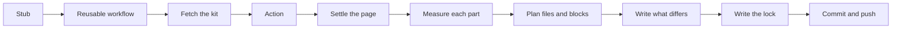

<!--
title: '🧭 HOW A RUN WORKS'
description: 'One run of the kit from the stub to the commit: how the workflow fetches the kit, and how the page is settled, measured, planned, written, locked and committed. Read it before changing src/app/, the lock or the reusable workflow.'
type: guide
-->

# 🧭 HOW A RUN WORKS

**One run, from the stub's schedule to the one commit it makes.**

_Measure everything. Write only what moved._

---

## 💡 The Shape Of A Run

A run is one job in the page's own repository. The stub names the schedule and
calls [`markdown.yml`](../../.github/workflows/markdown.yml) here at `@v1`. That
workflow checks the page out, fetches the kit beside it, runs the
[composite action](../../.github/actions/markdown/action.yml), and commits what
changed. Inside the action one command, `markdown-kit run`, settles the page,
measures every part, plans every file and README block, writes what differs,
keeps what it measured in the lock, and words the commit.

The run itself is [`src/app/run.py`](../../src/app/run.py), the page it draws is
[`src/app/page.py`](../../src/app/page.py), and each part measures and plans in
[`src/app/parts/`](../../src/app/parts/README.md). The README's blocks are
[`src/domain/readme.py`](../../src/domain/readme.py), the lock's shape is
[`src/domain/lock.py`](../../src/domain/lock.py), and every write goes through
[`src/infra/files.py`](../../src/infra/files.py).

---

## 🚀 In The Workflow

The reusable workflow has one job, **📝 Measure and draw**, with 30 minutes to
finish:

| Step                               | What it does                                                                                                                                                        |
| :--------------------------------- | :------------------------------------------------------------------------------------------------------------------------------------------------------------------ |
| The checkout                       | The caller's branch as it is now (`ref: github.ref_name`), with every commit and tag (`fetch-depth: 0`), which the elements read, and credentials kept for the push |
| 📥 Fetch the kit                   | tannergolden/markdown at `kit-ref`, `v1` unless the stub passes another, into `.markdown-kit/`, without credentials                                                 |
| 📝 The page                        | The action from `.markdown-kit/.github/actions/markdown`: `check` when the stub sets `check: true`, else `run`                                                      |
| 📤 Commit and push                 | When something changed and `commit` is `push`: commit as `author`, with `github-actions[bot]` as the committer, then fetch the branch, rebase onto it and push      |
| 🔀 Open or update the pull request | When `commit` is `pr`: the same change, on `commit-branch`, through the standards' `open-pr` action                                                                 |

The action refuses any command but `run`, `check` and `render`, and runs the kit
on whatever `python3` (or `python`) the runner has, with nothing installed. It
adds `.markdown-kit/` to the checkout's `.git/info/exclude`, so the fetched kit
is never a change. Each stub input that is set goes to the kit as
`--input key=value`, through environment variables rather than interpolated into
the script, and a `run` gets a `--commit-file` to word the commit in. Its
`changed` output compares `git status --porcelain --untracked-files=all` before
and after the kit ran.

The token is the stub's `MARKDOWN_TOKEN` when it passes one, else the run's own
`GITHUB_TOKEN`, and the kit reads whichever it is handed as `MARKDOWN_TOKEN`.
The reusable workflow sets no `concurrency` of its own: two runs on a branch
never draw at once only because the stub's `concurrency` group says so.

---

## 🧭 Settling The Page

Once per run, `settle` fixes everything a part needs that is not its own
measurement, and every part draws from the same page, so a page never mixes two
themes or two days:

- **Where it is.** `GITHUB_REPOSITORY` in Actions, or else the GitHub repository
  that `origin` points at.
- **Whose page, in which mode.** With `mode: auto`, a repository named after its
  owner is a profile and anything else a repository. An organization's `.github`
  would be its page, but organization pages are refused for now.
- **What day it is.** Today in the settings' `timezone`, UTC unless they name
  another, or the day `--today` gives.
- **What it is drawn in.** The first that applies: the Birthday set on the
  page's birthday; a holiday's set while its window is open and `holidays` is
  on; a collection's design, the month's or the one the settings name; a pixel
  theme's set, the same every day; the print a `rainbowprint` is on, which the
  lock remembers; and otherwise the theme. [Themes and Sets](Themes.md) defines
  each kind.
- **Where it goes.** The README (`readme`, `README.md` by default) and the
  folder the parts draw into (`out`, `assets` by default).

A repository's birthday is the day GitHub created it, read on the run and kept
in the lock, so a check knows it with no token.

---

## 📏 Measuring

Every part the settings leave on is measured. A part set to `false` is not, and
its files and its block are taken away on this run.

| Part     | Measured from                                                                                                                                                                        | The lock keeps            |
| :------- | :----------------------------------------------------------------------------------------------------------------------------------------------------------------------------------- | :------------------------ |
| Banners  | GitHub's GraphQL API: the repository, and on a profile the person; and the newest commit a person made on the default branch, reading back at most 500 commits                       | `parts.banners.last`      |
| Badges   | GitHub's API, for each live badge the kit measures: a workflow's newest finished run, the newest commit a person made, or the latest release                                         | `parts.badges.measured`   |
| Elements | git for the instruments, milestones, roster and certificate, and GitHub for what git cannot say, such as a placard or the certificate's CI verdict                                   | `parts.elements.measured` |
| Trophies | GitHub's GraphQL and REST APIs for every core value and achievement, and the commits themselves, a hundred to a page, at most `scan-pages` pages a run, cached by each branch's head | `parts.trophies`          |

A badge a workflow sets (`measure: set`) is not measured, and neither is an
element with no `measure:`. The GitHub client retries a 5xx answer or a rate
limit up to four times, doubling its wait from two seconds, and fails the run on
a refused token. A field the token may not read comes back empty with a
`GraphQL partial:` warning rather than failing the run, and whatever a part
could not read is said in a `note:` line and drawn short.

`run --save FILE` keeps the measurement as JSON, and `render --from FILE` and
`check --from FILE` draw from it.

---

## 🧩 Planning And Writing

`plan_page` turns the page and its measurement into one plan: every file by
path, every README block by name, and the notes. A part that is on but has
nothing measured to draw from, such as a trophy case before its first lock,
keeps its files and its block as they are.

Then the run writes, in this order:

1. **The files.** Each is written only when its bytes differ, through a
   temporary file moved into place, so a run that dies halfway leaves no half
   file.
2. **What is no longer drawn.** Every SVG under `out` that carries the kit's
   stamp and is not in the plan is deleted, with any folder that leaves empty.
   The stamp is the comment each drawing opens with, `<!--markdown-kit v1 ...-->`,
   or that of one of the three kits this one replaced. A file without one is
   never touched.
3. **The README's blocks.** A block already there is rewritten in place, and a
   block no longer drawn is taken out, markers and all. A new block goes where a
   README carries it: the header at the top, under a frontmatter comment if the
   file opens with one; the badges under the header; the trophy case over the
   footer; and the footer at the foot. An element goes only where its markers
   already stand. Without them the run draws its files, prints a `note:` and
   leaves the README alone.

Three things change the plan before it is written. A `rainbowprint` moves to the
next print of the spectrum when the plan would change what is committed, but not
while a set is up or as one comes down. An element drawn as of a moment is drawn
as of the moment the lock keeps, `parts.elements.asof`, and brought up to now
only when the page changes for another reason, so the clock alone never makes a
commit. And with `localize` on, the run also reads the repository's tracked
Markdown, draws each static shields.io badge it links to, and points those links
at the files.

---

## 🔒 The Lock

`.github/markdown.lock.json` holds what the committed files were drawn from.
Every value is measured again on every run; the lock adds only what GitHub
cannot say afterwards, and what `check` needs to draw the page again offline.

| Field                | Holds                                                                                                                                                                                                     |
| :------------------- | :-------------------------------------------------------------------------------------------------------------------------------------------------------------------------------------------------------- |
| `version`            | `1`. A kit that finds any other version refuses the lock                                                                                                                                                  |
| `drawn`              | The theme the page was drawn in, the set that was up (a holiday's key or `birthday`), the print a `rainbowprint` was on, the collection's design or the pixel theme, the day, and a repository's birthday |
| `parts.banners.last` | The banners' measurement: the mode, the subject, the day, the repository and the person                                                                                                                   |
| `parts.badges`       | Each measured badge's message and state, and with `localize`, the badges it drew and the branch their links name                                                                                          |
| `parts.elements`     | Each element's measurement, the elements drawn, and `asof`                                                                                                                                                |
| `parts.trophies`     | The case's ledger: the day each tier was first reached, a daily history of the core values kept for 400 days, the commit scanner's cache, and `last`, the measurement the case was drawn from             |
| `snapshot`           | The day the lock was last written for its own sake                                                                                                                                                        |

A run writes the lock when any file changed, when there is none yet, and seven
days after its last snapshot besides. That weekly write is a real commit, which
keeps GitHub from switching off the schedule after sixty quiet days in a
repository nobody pushes to. Deleting the lock loses history, never correctness.
`lock: false` stops a run writing it, and then `check` has nothing to draw from.
On a page the trophies kit drew before, the first run takes its
`.github/trophies.lock.json` over and removes it.

---

## 📝 The Commit

A `run` given `--commit-file` writes a Conventional Commit there whenever
something changed, and the workflow commits with it. Its subject is
`chore(markdown):`, an emoji and what moved, in 72 characters at most, and the
first of these that applies sets it:

| On a page    | When                                                                                                               | Subject                                                        |
| :----------- | :----------------------------------------------------------------------------------------------------------------- | :------------------------------------------------------------- |
| With banners | Something the banners show moved, or they are drawn for the first time                                             | 🪧 and what moved: `redraw with release v1.4.0 and 212 stars`  |
| Either       | The trophy case moved                                                                                              | 🏆 and the tier reached, the achievement earned, or the change |
| Either       | A holiday's set or the Birthday set went up or came down, or a collection's next design or a pixel theme took over | 💄 and the set, the design or the pixel theme                  |
| With banners | Anything else                                                                                                      | 🪧 `redraw the banners for` the page                           |
| Without      | The badges moved and no element was redrawn                                                                        | 🏷️ and the badges                                              |
| Without      | Anything else                                                                                                      | 📐 and the elements redrawn, or the page                       |

The body says what the page now shows, what changed since the last drawing, and
which files were redrawn or taken away. The kit sets its own commits aside: a
subject scoped `markdown`, or `banners`, `badges`, `trophies` or `elements` as
the kits it replaced wrote theirs, or a committer whose name or noreply address
ends in `[bot]`, is never counted as a page's last change or toward anyone's
trophies.

---

## 🔁 The Four Commands That Draw

| Command   | Measures                    | Writes the files and the README | Writes the lock           | Token |
| :-------- | :-------------------------- | :------------------------------ | :------------------------ | :---- |
| `run`     | Yes, through GitHub and git | Yes                             | Yes                       | Yes   |
| `render`  | No: the lock, or `--from`   | Yes                             | No                        | No    |
| `check`   | No: the lock, or `--from`   | No: it compares, byte for byte  | No                        | No    |
| `preview` | No: a sample measurement    | Yes, into `--root`              | Yes, so the folder checks | No    |

A `check` draws the page as of the day the lock says it was drawn, so a page
committed in a holiday's set checks in that set. It exits 1 when anything
differs, naming each difference, and 2 when the lock holds no measurement to
draw the banners or the trophy case from, where the settings leave them on. What
each difference means is in
[Troubleshooting A Run](../operations/Troubleshooting-A-Run.md), and every flag
is in [Command Line](../references/Command-Line.md).

---

### 🔗 See also

- [Settings](../references/Settings.md) - every key a run reads
- [Source Code](Source-Code.md) - the layers these modules sit in, and the rules between them
- [Releasing The Kit](../distribution/Releasing-The-Kit.md) - how a change reaches every page's next run

---

**Measured fresh each night, committed only when it moved.**

[↑ Back to Top](#top)

 

Built with ❤️ by the Engineering Team. Distributed under the terms in [LICENSE](/LICENSE).

